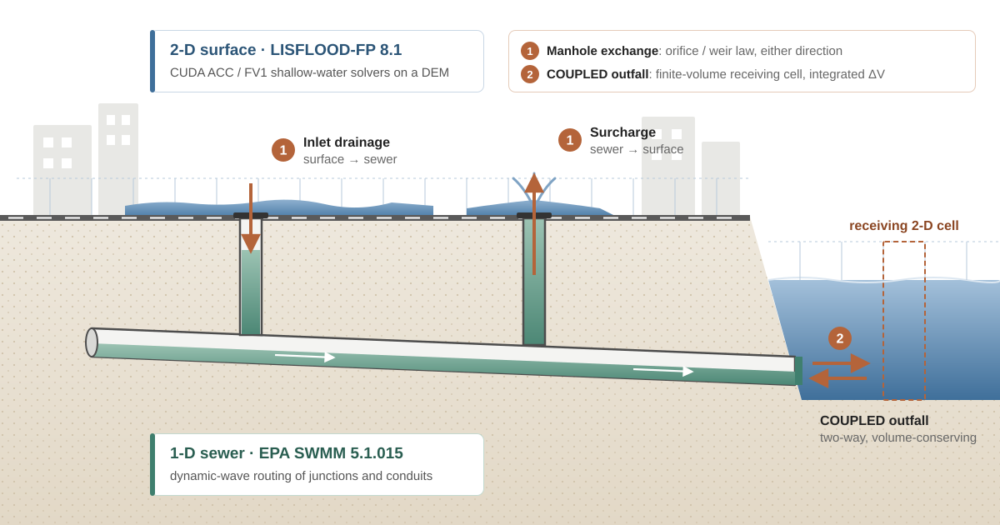
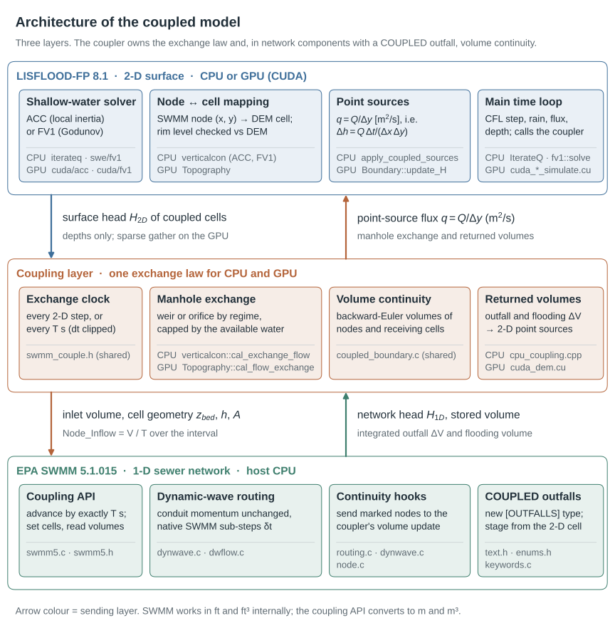

<div align="center">

# LISFLOOD-SWMM: A Two-Way Coupled Dual-Drainage Urban Flood Model

**Two-way coupling of a 2-D surface flood model and a 1-D urban drainage model, on CPU or GPU**

[](LICENSE)
[](https://github.com/FloodGroup/LISFLOOD-SWMM-Coupling/releases/latest)
[](https://zenodo.org/records/6912932)
[](https://github.com/USEPA/Stormwater-Management-Model)
[](docs/user_guide.md#2-build)
[](https://cmake.org)

[Overview](#overview) ·
[How it works](#how-the-coupling-works) ·
[Quick start](#quick-start) ·
[Documentation](#documentation) ·
[Citation](#citation)

</div>

<p align="center">
  
</p>

## Overview

This repository couples the 2-D hydrodynamic model [LISFLOOD-FP](https://www.bristol.ac.uk/geography/research/hydrology/models/lisflood/) with the 1-D sewer model [EPA SWMM](https://www.epa.gov/water-research/storm-water-management-model-swmm) inside a single executable. Surface water and pipe water exchange in both directions while both models run, with the 2-D model on multi-core CPUs (OpenMP) or on an NVIDIA GPU (CUDA):

- **Manholes** drain surface water into the sewer, or spill sewer water onto the street when the network surcharges. Surcharge and drowned inflow follow orifice laws, and free inflow over the manhole crest follows a weir law, all driven by the head difference between the two models.
- **`COUPLED` outfalls**, a new SWMM outfall type, let the sewer discharge into a river or coastal cell of the 2-D grid and take water back when that cell is higher. The receiving cell is treated as a finite volume, so the outfall cannot create or lose water.
- **SWMM node flooding** is returned to the 2-D cell above the node instead of disappearing from the model.

The model retains LISFLOOD-FP's surface-flow solvers and SWMM's conduit dynamic-wave momentum equations. In network components containing a `COUPLED` outfall, the coupling layer uses a volume-based continuity update and accounts for water crossing the surface-network interface.

| | |
|---|---|
| **Coupled surface solvers** | ACC (local inertia) and FV1 (first-order Godunov), each on CPU or GPU |
| **Back ends** | CPU with OpenMP; CUDA GPU when built with a CUDA compiler. One keyword (`cuda`) switches a case between them. |
| **Exchange law** | identical on CPU and GPU: orifice surcharge, weir free inflow, orifice submerged inflow |
| **Exchange interval** | every 2-D step, or every *T* seconds with exact time landing |
| **Data transfer on GPU** | only the depths of coupled cells move between device and host |
| **Mass balance** | volume-based continuity at coupled outfalls, supply-limited withdrawals everywhere, and a per-run water-balance audit on GPU |

## How the coupling works

<p align="center">
  
</p>

Each 2-D time step, the coupler reads the water depth in every cell that contains a manhole, computes the manhole discharge, and adds it to the surface as a point source. The same discharge is accumulated as inflow for SWMM. When an exchange is due, SWMM advances by exactly the elapsed interval using its own sub-steps. It receives the accumulated inflow as a constant rate and the current water level of every receiving cell. SWMM then returns the volume that actually crossed each `COUPLED` outfall and each flooded node, and LISFLOOD-FP applies those volumes to the surface.

The CPU and CUDA drivers run this cycle with the same equations, the same limits and the same exchange clock.

The full derivation, every equation with the CPU and CUDA functions that implement it, and the time-synchronisation rules are in [**docs/coupling_methodology.md**](docs/coupling_methodology.md).

## Quick start

### Requirements

| | |
|---|---|
| Compiler | MSVC 2019 / 2022 on Windows, or GCC / Clang on Linux (C++14) |
| Build | CMake ≥ 3.13, OpenMP |
| Libraries | NetCDF + HDF5 + zlib (can be disabled), `libnuma` on Linux |
| GPU (optional) | NVIDIA GPU with CUDA Toolkit ≥ 11, for GPU acceleration |

### Build

```bash
# Linux
cmake -S . -B build -DCMAKE_BUILD_TYPE=Release -DCMAKE_CUDA_ARCHITECTURES=86
cmake --build build --target lisflood -j
```

```powershell
# Windows (MSVC + NMake)
.\tools\build.ps1 -VcVars "C:\...\vcvars64.bat" -CMake "C:\...\cmake.exe" -CudaArchitecture 86
```

If CMake finds a CUDA compiler, the executable contains both the CPU and the CUDA solvers; otherwise it is a CPU build. `CMAKE_CUDA_ARCHITECTURES` is your GPU's compute capability (86 for RTX 30xx, 89 for RTX 40xx) and is ignored in a CPU build. Windows NetCDF libraries and other build options are covered in the [user guide](docs/user_guide.md#2-build).

### Run the coupled example

```bash
cd examples/02_coupled_synthetic
lisflood case.par
```

The example runs on the CPU. Add a line `cuda` to `case.par` to run it on the GPU.

A coupled `.par` file adds a few keywords to a normal LISFLOOD-FP run:

```text
acceleration                    # or fv1
cuda                            # optional: run the 2-D solver on the GPU
swmminp      network.inp        # SWMM network with COUPLED outfalls
floodconfig  floodconfig.txt    # manhole <-> cell exchange table
coupleint    step               # or a positive number of seconds
```

## Documentation

| Document | What it covers |
|---|---|
| [User guide](docs/user_guide.md) | Building for CPU or GPU, preparing a coupled case, every coupling keyword, the `floodconfig` format, outputs, hotstart, troubleshooting |
| [Coupling methodology](docs/coupling_methodology.md) | Architecture, the step-by-step exchange cycle, manhole and outfall equations, time synchronisation, mass-balance audit |
| [Examples](examples/README.md) | Two small runnable cases: surface-only smoke test and a synthetic coupled network |
| [Source map](src/README.md) | Where the coupling code lives inside `src/`, and what was changed relative to upstream |

## Repository layout

```text
.
├── docs/
│   ├── coupling_methodology.md   how the two models exchange water
│   ├── user_guide.md             build, inputs, outputs, troubleshooting
│   └── figures/                  SVG schematics used by the docs
├── examples/
│   ├── 01_surface_only_drycheck/ standalone LISFLOOD-FP smoke test
│   └── 02_coupled_synthetic/     minimal coupled case (one junction, one COUPLED outfall)
├── src/                          LISFLOOD-FP 8.1 + SWMM 5.1.015 + coupling layer (CPU and CUDA)
├── tools/
│   ├── build.ps1                 Windows build script
│   └── run.ps1                   Windows launcher used in the binary package
├── CITATION.cff
└── LICENSE                       GPL-2.0
```

## Upstream versions and licence

| Component | Version | Licence |
|---|---|---|
| LISFLOOD-FP | **8.1.0** development snapshot, git commit `637106b` (2022-04-20). This commit is in the Zenodo 8.2 source history but is not the Zenodo 8.1 / 8.2 release archive. | GPL-2.0 ([Zenodo 8.1](https://zenodo.org/records/6912932)) |
| EPA SWMM | **5.1.015** (`VERSION 51015` in `src/consts.h`; cf. [USEPA v5.1.15](https://github.com/USEPA/Stormwater-Management-Model)) | Public domain |

**The whole repository is released under GPL-2.0** ([`LICENSE`](LICENSE)). SWMM is public domain and is distributed here under the same licence; its use does not imply endorsement by the U.S. EPA.

Pre-built Windows binaries are published on the **Releases** page, not in the git tree. They include Microsoft and Intel runtime libraries under those vendors' redistribution terms; see `THIRD_PARTY_NOTICES.txt` inside the archive.

## Citation

If you use this software, please cite it using [`CITATION.cff`](CITATION.cff) (GitHub shows a *Cite this repository* button), and also cite LISFLOOD-FP and SWMM:

- Shaw, J., Kesserwani, G., Neal, J., Bates, P. and Sharifian, M. K. (2021). LISFLOOD-FP 8.0: the new discontinuous Galerkin shallow-water solver for multi-core CPUs and GPUs. *Geoscientific Model Development*, 14, 3577–3602. <https://doi.org/10.5194/gmd-14-3577-2021>
- Rossman, L. A. (2015). *Storm Water Management Model User's Manual, Version 5.1*. EPA/600/R-14/413b, U.S. Environmental Protection Agency.

## Acknowledgements

- LISFLOOD-FP: University of Bristol Hydrology Research Group and contributors
- EPA SWMM: U.S. Environmental Protection Agency
- Coupling layer: FloodGroup
