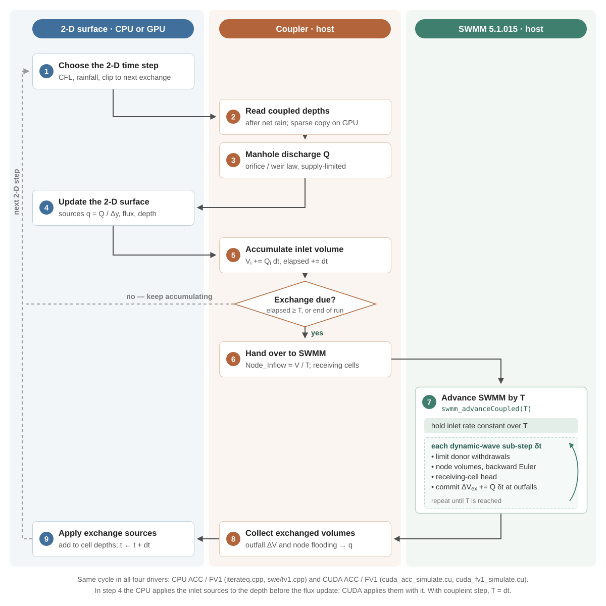
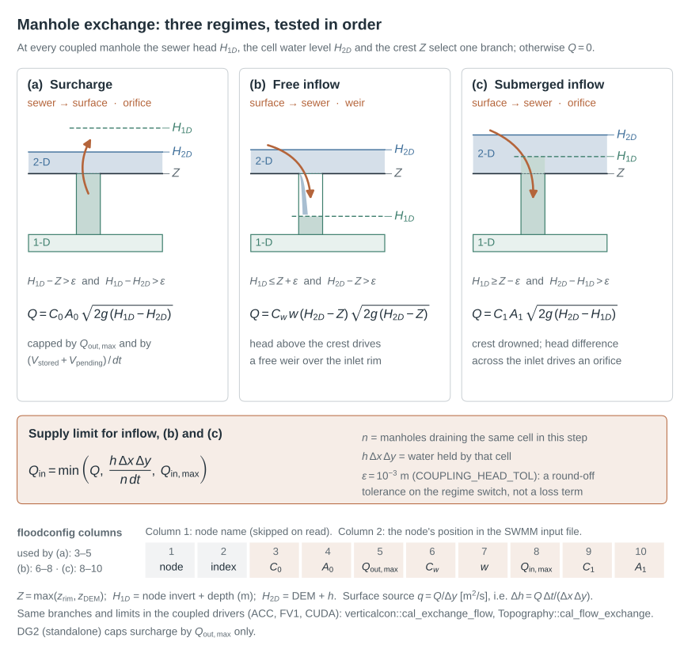
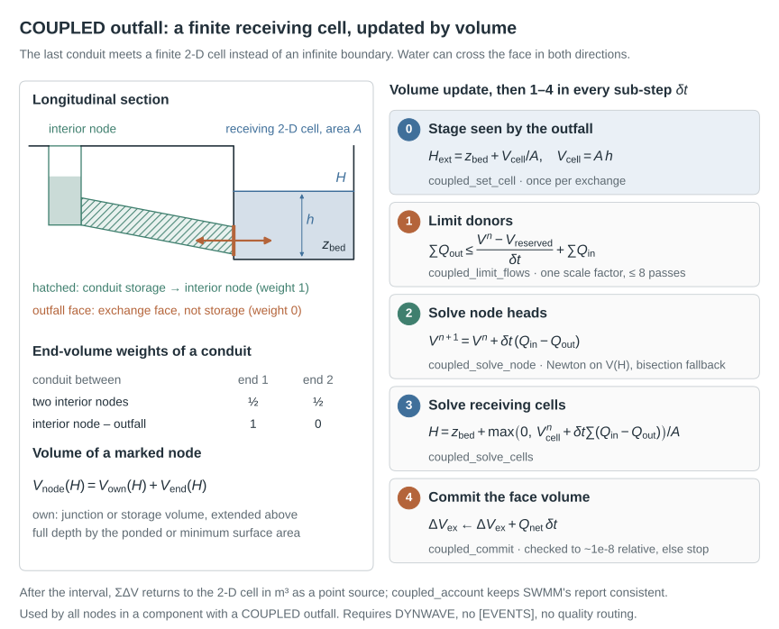
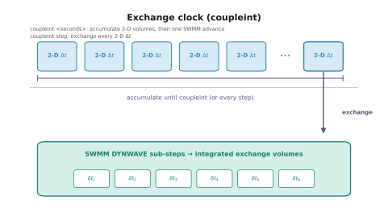

# Coupling methodology

This document explains how LISFLOOD-FP and SWMM exchange water in this repository. The same exchange is implemented for the CPU solvers and for the CUDA (GPU) solvers; each equation is followed by the functions that implement it on both, so the text can be checked against the source.

**Contents**

1. [Design principles](#1-design-principles)
2. [Architecture](#2-architecture)
3. [One coupling cycle](#3-one-coupling-cycle)
4. [Linking SWMM nodes to 2-D cells](#4-linking-swmm-nodes-to-2-d-cells)
5. [Manhole exchange](#5-manhole-exchange)
6. [COUPLED outfalls](#6-coupled-outfalls)
7. [Ordinary outfalls and node flooding](#7-ordinary-outfalls-and-node-flooding)
8. [Time synchronisation](#8-time-synchronisation)
9. [Units](#9-units)
10. [Water-balance audit](#10-water-balance-audit)
11. [Requirements and limitations](#11-requirements-and-limitations)
12. [Source map](#12-source-map)

---

## 1. Design principles

- **Keep both physics engines.** LISFLOOD-FP still solves the 2-D shallow-water equations and SWMM still solves the 1-D dynamic-wave equations. The coupling layer only adds exchange terms and, in network components that contain a `COUPLED` outfall, replaces SWMM's continuity update with a volume-based one.
- **One exchange law on every back end.** The manhole law, the inflow limits, the exchange clock and the SWMM side are shared by the CPU and CUDA builds. Switching between `acceleration` and `fv1`, or adding `cuda` to the parameter file, changes the 2-D solver but not the coupling.
- **Exchange volumes, not instantaneous rates.** SWMM is advanced across the whole exchange interval with its own sub-steps, and the volume that actually crossed each interface is returned to the surface (`swmm_advanceCoupled` in `swmm5.c`).
- **Never withdraw water that is not there.** Every withdrawal is capped by the water available in the donor: the 2-D cell for inlet drainage, the sewer storage for surcharge, and the receiving cell or junction for outfall exchange.
- **Move as little data as possible on the GPU.** Only the depths of coupled cells are copied from the device to the host each step (`gather_coupling_depths`). The CPU solvers read the depth array directly.

## 2. Architecture

  

The coupled executable has three layers. LISFLOOD-FP owns the surface grid and the main time loop, on the CPU or on the GPU. The coupling layer owns the exchange clock, the node and outfall mapping, the manhole discharge law and the receiving-cell bookkeeping. SWMM owns the sewer network and exposes a small coupling API.

| SWMM API (`swmm5.h`) | Purpose |
|---|---|
| `swmm_beginCoupledExchange()` | reset per-interval exchange totals |
| `swmm_setOutfallReceivingCell(node, cell, bed, depth, area)` | give a `COUPLED` outfall the current state of its 2-D cell (SI units) |
| `swmm_advanceCoupled(T, &elapsed)` | route the network forward by exactly `T` seconds |
| `swmm_getOutfallExchangeVolume(node)` | volume that crossed an outfall during the interval (m³) |
| `swmm_getNodeFloodExchangeVolume(node)` | node flooding volume during the interval (m³) |
| `swmm_getNodeAvailableCoupledVolume(node)` | water stored at a node, used to cap surcharge (m³) |

The 2-D side of the coupling has one implementation per back end:

| Task | CPU | CUDA |
|---|---|---|
| Node mapping and manhole law | `flood::verticalcon` (`iterateq.cpp`, ACC), `floodfv1::verticalcon` (`swe/fv1.cpp`, FV1) | `lis::cuda::Topography` (`cuda/cuda_dem.cu`) |
| Outfall mapping, outfall stages, returned volumes | `lis::cpu_coupling` (`cpu_coupling.cpp`) | `lis::cuda::Topography` (`cuda/cuda_dem.cu`) |
| Main loop | `IterateQ` (`iterateq.cpp`), `fv1::solve` (`swe/fv1.cpp`) | `cuda/acc/cuda_acc_simulate.cu`, `cuda/fv1/cuda_fv1_simulate.cu` |

## 3. One coupling cycle

  

All four drivers (CPU ACC, CPU FV1, CUDA ACC, CUDA FV1) run the same cycle:

| Step | What happens | CPU | CUDA |
|:---:|---|---|---|
| 1 | The 2-D step `dt` is set by the CFL condition and rainfall clipping. In interval mode it is also shortened so the exchange time lands exactly on the interval boundary; in step mode it may not pass the end of the SWMM run. | `FloodplainQ` (ACC), `Tstep_from_cfl` (FV1), `clip_step`, `swmm_couple_clip_dt` | `update_dt_ACC`, `clip_step`, `swmm_couple_clip_dt` |
| 2 | Net rainfall and infiltration are applied, then the depths of the coupled cells are read. | `DynamicRain::update_H`; depths read from the host array | `DynamicRain::updateACC` (ACC), `DynamicRain::update` (FV1); `gather_coupling_depths` copies the coupled depths to the host |
| 3 | The discharge through every manhole is computed from the SWMM node head and the surface water level ([§5](#5-manhole-exchange)). | `verticalcon::cal_exchange_flow` | `Topography::cal_flow_exchange` |
| 4 | The manhole discharges become point sources on the surface. | `apply_coupled_sources` (ACC), `update_point_sources` (FV1) | `Boundary::update_H` |
| 5 | Inlet volumes are accumulated: \(V_i \mathrel{+}= Q_i\,dt\). | `swmm_couple_accumulate` | `swmm_couple_accumulate` |
| — | If the interval is not complete, the loop continues with the next 2-D step. | `swmm_couple_due` | `swmm_couple_due` |
| 6 | The accumulated volume is passed to SWMM as a constant inflow rate `Node_Inflow = V / T`, and each `COUPLED` outfall receives the bed, depth and area of its cell. | `swmm_couple_write_inflow`, `cpu_coupling::update_outfall_stages` | `swmm_couple_write_inflow`, `Topography::update_outfall_stages` |
| 7 | SWMM routes the network forward by `T`. Inside every dynamic-wave sub-step the coupled components use the volume-based update of [§6](#6-coupled-outfalls). | `swmm_advanceCoupled` | `swmm_advanceCoupled` |
| 8 | Exchanged volumes at outfalls and flooded nodes are read back and converted to point-source fluxes. | `cpu_coupling::collect_return_sources` | `collect_outfall_source_values`, `collect_surface_flood_values` |
| 9 | The returned sources are added to the surface depths and the exchange clock is reset. | `apply_coupled_sources` (ACC), `update_point_sources` (FV1), `swmm_couple_advance` | `update_point_sources_range`, `swmm_couple_advance` |

With `coupleint step`, steps 5 and 6 collapse: the inflow of the current step is passed directly (`nodeinflow_cal`) and `T` equals `dt`.

**Order within a step.** Rainfall and infiltration are applied before the manhole discharge is computed, so the two sinks cannot both remove the same surface water. The CPU drivers then apply the inlet sources to the depths directly, before the flux divergence; the CUDA drivers apply them together with the flux divergence in `Boundary::update_H`. Both give the same volume per step.

## 4. Linking SWMM nodes to 2-D cells

Manholes are listed explicitly in the `floodconfig` table ([user guide §4](user_guide.md#4-the-floodconfig-table)). Outfalls are found automatically from the SWMM input. The rules below are identical on the CPU and the GPU.

**Manholes.** For each row of `floodconfig`, the node's SWMM coordinates are converted to a DEM cell (`cal_dem_index` on the CPU, `cal_demindex` on the GPU):

$$
i_x = \left\lfloor \frac{x - x_{\min}}{\Delta x} \right\rfloor, \qquad
i_y = \left\lfloor \frac{y_{\max} - y}{\Delta y} \right\rfloor
$$

A node is excluded from exchange (index `-9999`) when it lies outside the DEM, falls on a NoData cell, or is an `OUTFALL`, `STORAGE` or `DIVIDER` node. The rim elevation \(z_{\text{rim}} = z_{\text{invert}} + d_{\text{full}}\) is compared with the DEM, and differences above 0.1 m are reported (`check_nodedepth`, `fix_maxdepth`). When several manholes share one cell, they are grouped so the cell's water is shared fairly (`demcountuni_cal`, `cal_demcount`).

**Outfalls.** Every SWMM outfall whose coordinates fall inside the DEM, on a valid cell, is mapped to that cell (`map_internal_outfalls`). Outfalls outside the DEM remain ordinary external sinks. A `COUPLED` outfall that cannot be mapped stops the run.

All mapping decisions are written to the file named by the `flooderror` keyword.

## 5. Manhole exchange

  

Three heads are compared at every coupled manhole (`verticalcon::cal_exchange_flow` in `iterateq.cpp` and `swe/fv1.cpp`; `Topography::cal_flow_exchange` in `cuda_dem.cu`):

| Symbol | Definition |
|---|---|
| \(H_{1D}\) | SWMM node head, invert + depth, converted to metres |
| \(H_{2D}\) | water surface in the linked cell, DEM + depth |
| \(Z\) | crest elevation, \(\max(z_{\text{rim}},\, z_{\text{DEM}})\) |

The branches are tested in order with a numerical tolerance \(\varepsilon = 10^{-3}\) m (`COUPLING_HEAD_TOL`, `consts.h`), which keeps the regime from switching on round-off:

**(a) Surcharge, sewer → surface**, when \(H_{1D} - Z > \varepsilon\) and \(H_{1D} - H_{2D} > \varepsilon\). The manhole acts as an orifice:

$$
Q = \min\!\Big( C_0 A_0 \sqrt{2g\,(H_{1D} - H_{2D})},\;\; Q_{\text{out,max}},\;\; \frac{V_{\text{stored}} + V_{\text{pending}}}{dt} \Big)
$$

The last term prevents the manhole from releasing more water than SWMM currently holds at that node, including inflow already accumulated for the next exchange.

**(b) Free inflow, surface → sewer**, when \(H_{1D} \le Z + \varepsilon\) and \(H_{2D} - Z > \varepsilon\). The sewer head is below the crest, so the inlet behaves as a weir:

$$
Q = C_w\, w\, (H_{2D} - Z)\sqrt{2g\,(H_{2D} - Z)}
$$

**(c) Submerged inflow, surface → sewer**, when \(H_{1D} \ge Z - \varepsilon\) and \(H_{2D} - H_{1D} > \varepsilon\). The crest is drowned, so the inlet acts as an orifice:

$$
Q = C_1 A_1 \sqrt{2g\,(H_{2D} - H_{1D})}
$$

Otherwise \(Q = 0\).

**Supply limit for inflow.** After branch selection, inflow in (b) and (c) is limited by the water in the cell, shared among the \(n\) manholes draining that cell in this step, and by the inlet capacity:

$$
Q_{\text{in}} = \min\!\Big( Q,\;\; \frac{h\,\Delta x\,\Delta y}{n\,dt},\;\; Q_{\text{in,max}} \Big)
$$

**Sign convention.** `flow_1D_node` is positive into the sewer; `flow_2D_node` has the opposite sign, so it is positive towards the surface. The surface receives `flow_2D_node / Δy` as a per-width point-source flux (m²/s), which is how LISFLOOD-FP stores point sources.

## 6. COUPLED outfalls

  

A standard SWMM outfall imposes a stage, such as free outfall, normal depth or a fixed level, and its receiving water is infinite. A `COUPLED` outfall instead connects the last conduit to a finite 2-D cell, so water leaving the sewer raises that cell and a high cell pushes water back into the pipe. The SWMM side is in `coupled_boundary.c` and is shared by the CPU and CUDA builds.

### 6.1 Which nodes use the volume update

At start-up `coupled_open` finds the connected components of the network with a union–find pass over all links. Every node in a component that contains at least one `COUPLED` outfall is *marked*. Marked nodes use the volume-based continuity below; all other nodes keep SWMM's native depth update. Conduit momentum is solved by SWMM's dynamic wave everywhere.

### 6.2 Storage attribution

Conduit storage is split between the two end nodes (`end_volume`):

| Conduit between | Weight at each end |
|---|---|
| two interior nodes | ½ and ½ |
| an interior node and an outfall | 1 at the interior node, 0 at the outfall |

The outfall is an **exchange face**, not a storage node. Giving it zero weight means a dry pipe cannot gain water just because the receiving cell has a bed elevation above the outfall invert. The volume of a marked node is

$$
V_{\text{node}}(H) = V_{\text{own}}(H) + V_{\text{end}}(H)
$$

where \(V_{\text{own}}\) is the SWMM junction or storage volume, extended above full depth by the ponded area (if ponding is allowed) or by the minimum surface area (`own_volume`).

### 6.3 Receiving cell

Each exchange, the 2-D model passes the cell's bed \(z_{\text{bed}}\), depth \(h\) and area \(A\) (`coupled_set_cell`). The cell holds \(V_{\text{cell}} = A\,h\), and the outfall sees the stage

$$
H_{\text{ext}} = z_{\text{bed}} + \frac{V_{\text{cell}}}{A}
$$

Several outfalls may share one cell; their net flows are summed.

### 6.4 Volume update inside each SWMM sub-step

For each dynamic-wave sub-step \(\delta t\) (hooks in `dynwave.c` and `routing.c`):

1. **Limit donors** (`coupled_limit_flows`). The sum of withdrawals from a receiving cell or a marked junction may not exceed what is available. Water already promised to the 2-D surface for the rest of the interval is reserved:

   $$
   \sum Q_{\text{out}} \;\le\; \frac{V^{n} - V_{\text{reserved}}}{\delta t} + \sum Q_{\text{in}}
   $$

   If the limit is exceeded, all donor link flows, evaporation and seepage at that node are scaled by one common factor (`scale_donor`). Up to eight passes resolve chains of donors.

2. **Solve node heads** (`coupled_solve_node`). Backward-Euler continuity gives a target volume, and the head is found by a safeguarded Newton inversion of \(V_{\text{node}}(H)\) (`inverse_volume`):

   $$
   V^{n+1} = V^{n} + \delta t\,(Q_{\text{in}} - Q_{\text{out}})
   $$

   If ponding is off and the head exceeds the rim, the excess becomes the node overflow rate.

3. **Solve receiving cells** (`coupled_solve_cells`):

   $$
   H = z_{\text{bed}} + \frac{\max\!\big(0,\; V_{\text{cell}}^{n} + \delta t \sum (Q_{\text{in}} - Q_{\text{out}})\big)}{A}
   $$

4. **Commit** (`coupled_commit`). The volume equations are checked against their targets (relative tolerance about \(10^{-8}\)). The run stops with an error rather than continuing with a mass error. The volume credited at each outfall face is

   $$
   \Delta V_{\text{ex}} \mathrel{+}= Q_{\text{net}}\,\delta t - \big(V_{\text{end}}^{n+1} - V_{\text{end}}^{n}\big) = Q_{\text{net}}\,\delta t
   $$

   because the end-volume weight at the face is zero. The general form is kept in the code for clarity.

5. **Account** (`coupled_account`). SWMM's routing totals are corrected so its own continuity report stays consistent with the backward-Euler update.

After the interval, \(\sum \Delta V_{\text{ex}}\) is returned to LISFLOOD-FP in m³ (`coupled_exchange`) and applied to the receiving cell as a point source. On the CPU, `collect_return_sources` also checks that a reverse flow (cell → sewer) never takes more water than the cell holds.

### 6.5 Requirements checked at start-up

`coupled_open` and `map_internal_outfalls` stop the run unless all of these hold:

- `FLOW_ROUTING DYNWAVE`, with continuous routing (no `[EVENTS]` section);
- no water-quality routing, or `IGNORE_QUALITY YES`;
- every `COUPLED` outfall lies on a valid (non-NoData) DEM cell.

## 7. Ordinary outfalls and node flooding

| Situation | Treatment |
|---|---|
| Ordinary outfall (`FREE`, `NORMAL`, `FIXED`, …) **inside** the DEM | keeps its SWMM boundary condition; its positive discharge is added to the cell as a one-way source |
| Ordinary outfall **outside** the DEM | external sink, as in standalone SWMM |
| SWMM node flooding (overflow above the rim) | the flooded volume is returned to the mapped 2-D cell (`collect_return_sources` on the CPU, `collect_surface_flood_values` on the GPU); a flooded node with no mapping stops the run |

## 8. Time synchronisation

  

The exchange clock is `SwmmCoupleClock` in `swmm_couple.h`. It is used unchanged by all four drivers:

| Mode | Behaviour |
|---|---|
| `coupleint step` | one SWMM exchange after every 2-D step; `T = dt` |
| `coupleint T` (seconds) | 2-D steps accumulate inlet volume until their durations sum to `T`, then SWMM advances once by `T` |

In interval mode:

- `swmm_couple_clip_dt` shortens the last 2-D step so the interval ends exactly on `T`, or at the end of the 2-D run or the SWMM run, whichever comes first.
- `swmm_couple_write_inflow` passes the interval-mean inflow `V / T` to SWMM. `coupled_sync_inlets` holds this rate constant at both ends of SWMM's trapezoidal lateral-inflow integration, so the volume SWMM receives equals the volume removed from the surface.
- `swmm_advanceCoupled` caps each SWMM routing step so the network lands exactly on `t + T`, and fails if it does not.
- Outfall and flooding volumes returned for the interval are applied to the surface in the step that closes the interval.

A shorter interval couples the two models more tightly. A longer interval reduces the number of SWMM calls and, on the GPU, the number of host–device transfers.

## 9. Units

SWMM works internally in feet, cubic feet and seconds, whatever `FLOW_UNITS` the input uses. The coupling API converts at the boundary:

| Quantity | Conversion |
|---|---|
| volume | 1 ft³ = 0.028316846592 m³ |
| length | 1 ft = 0.3048 m |
| node head to the 2-D model | `UCF(LENGTH)` |

DEM coordinates and SWMM `[COORDINATES]` must use the same projected coordinate system, in metres.

## 10. Water-balance audit

Every coupled run can be checked with the SWMM report (`swmmrpt`, continuity errors) and the LISFLOOD-FP mass file (`<resroot>.mass`). The CUDA drivers also write two audit files next to the other outputs (`cuda/run_audit.cuh`):

| File | Content |
|---|---|
| `<resroot>.audit.log` | run settings, periodic progress lines with the combined residual, and the final state |
| `<resroot>.water_balance.csv` | time series of 2-D and 1-D storage, rain, inlet and outfall exchange in both directions, pending exchange, and the combined balance residual (m³) |

Coupling entries are signed from the 2-D point of view. Inflow accumulated but not yet passed to SWMM is reported as `pending_to_1d_m3` and included in the combined balance.

## 11. Requirements and limitations

- Coupled runs require `acceleration` or `fv1`, on the CPU or with `cuda`. Other solvers, including FV2 and DG2, run standalone only.
- `coupleint` accepts `step` or a positive interval for all four coupled drivers.
- Hotstart (`hsfdt`, `hsffloodread`, …) is available for the ACC solver, on the CPU and the GPU. FV1 runs start from `startfile`.
- The audit files of [§10](#10-water-balance-audit) are written by the CUDA drivers only.
- A manhole exchanges with exactly one 2-D cell, the cell that contains its coordinates.
- The `floodconfig` row index is the node's position in the SWMM input file, not its name ([user guide §4](user_guide.md#4-the-floodconfig-table)). Reordering the input file changes the mapping.
- Hotstart files written by an uncoupled LISFLOOD-FP or SWMM may define pipe storage differently. Rebuild hotstarts with this model.

## 12. Source map

| Topic | Files |
|---|---|
| Exchange clock | `src/swmm_couple.h` |
| Receiving-cell volumes, donor limits, exchange volumes | `src/coupled_boundary.c`, `src/coupled_boundary.h` |
| SWMM coupling API | `src/swmm5.c`, `src/swmm5.h` |
| Hooks in SWMM routing | `src/dynwave.c`, `src/routing.c`, `src/node.c` |
| `COUPLED` keyword | `src/text.h`, `src/enums.h`, `src/keywords.c` |
| Node mapping, manhole discharge (CPU) | `src/iterateq.cpp` (ACC), `src/swe/fv1.cpp` (FV1) |
| Outfall mapping, outfall stages, returned volumes (CPU) | `src/cpu_coupling.cpp`, `src/cpu_coupling.h` |
| Node and outfall mapping, manhole discharge (CUDA) | `src/cuda/cuda_dem.cu` |
| GPU depth gather | `src/cuda/cuda_coupling_gather.cuh` |
| Point sources (CUDA) | `src/cuda/cuda_boundary.cu` |
| Main loops | `src/iterateq.cpp`, `src/swe/fv1.cpp`, `src/cuda/acc/cuda_acc_simulate.cu`, `src/cuda/fv1/cuda_fv1_simulate.cu` |
| Water-balance audit (CUDA) | `src/cuda/run_audit.cuh` |
| `.par` keywords and validation | `src/pars.cpp`, `src/lisflood.cpp` |
