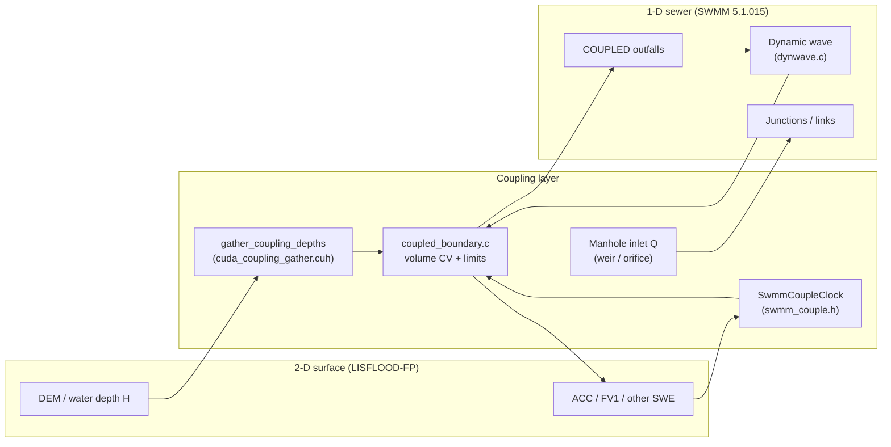
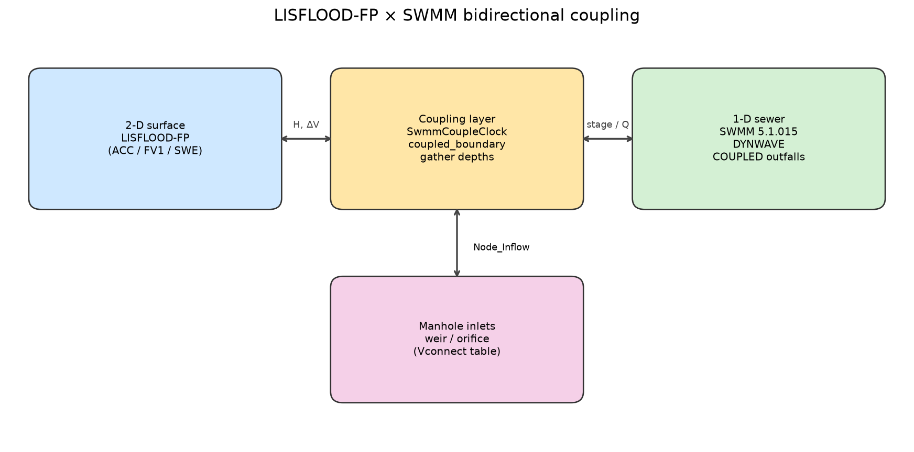
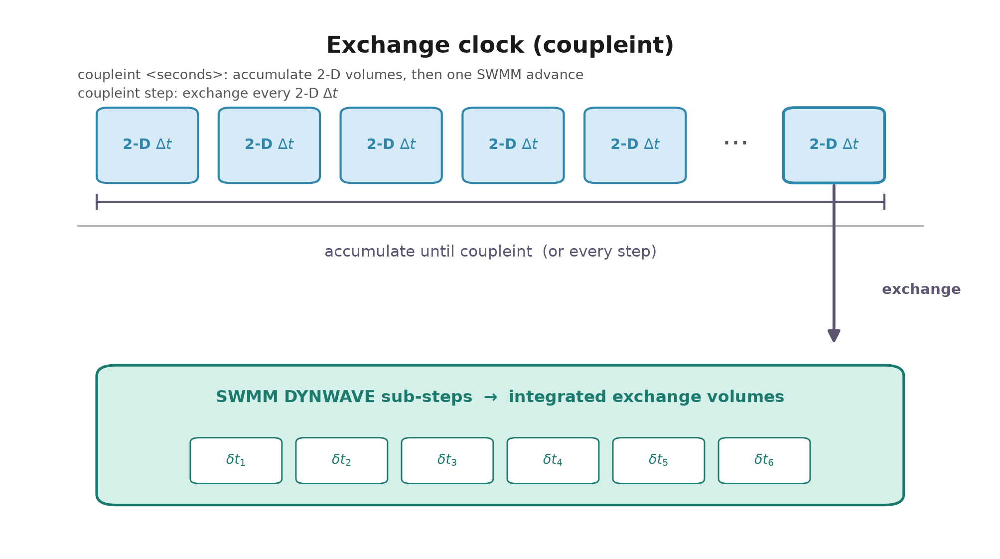
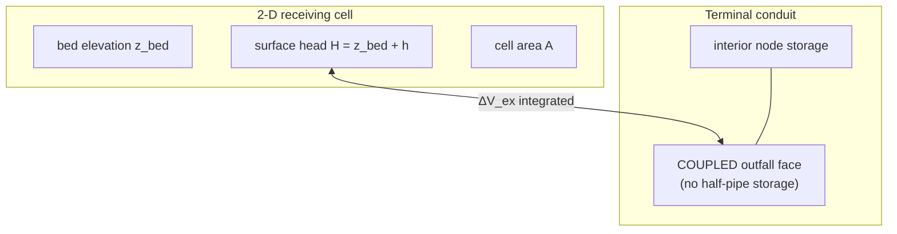
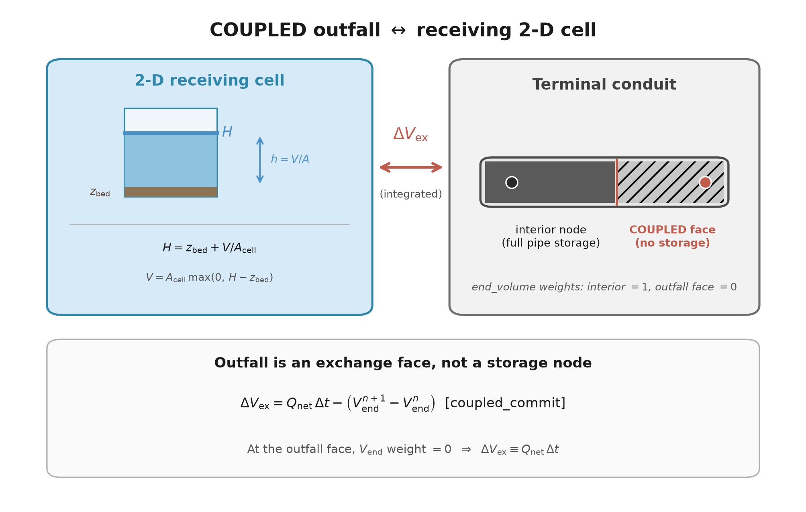

# Coupling methodology

This document describes the bidirectional surface–sewer coupling implemented in this repository. Every formula and behavioural claim cites the implementing file and function. Internal SWMM storage uses US customary units (feet, ft³, s); the public exchange API converts to SI (m, m³) with the factor `0.028316846592` ft³ → m³ (`coupled_boundary.c`).

## Overview





## What was changed relative to upstream

1. **New files**: `coupled_boundary.c` / `.h`, `swmm_couple.h`, `cuda/cuda_coupling_gather.cuh` (plus packaging / build helpers).
2. **LISFLOOD-FP (~47 files)**: main loops (CPU and CUDA ACC/FV1) call SWMM advance + exchange; DEM–node mapping; point-source injection of exchange volumes; `.par` keywords `swmminp`, `swmmrpt`, `swmmout`, `coupleint`.
3. **SWMM (~17 files)**: new outfall type `COUPLED_OUTFALL`; coupling APIs in `swmm5.c`; dynamic-wave hooks; volume accounting.

Full file list: [`CHANGES.md`](../CHANGES.md).

## Coupling modes

### A. `COUPLED` outfalls ↔ receiving 2-D cells (volume control volumes)

Outfalls declared `COUPLED` in the SWMM `.inp` (`text.h`: `w_COUPLED`; `enums.h`: `COUPLED_OUTFALL`) are mapped to one or more surface cells. The outfall is treated as an **exchange face**, not an extra storage node (`coupled_boundary.c` file header and `end_volume()`).

Receiving-cell geometry is supplied each exchange interval by `coupled_set_cell(node, cell, bed, depth, area)`:

- `bed`, `depth`, `area` are SI (m, m, m²).
- Internally: `bed_ft = bed/0.3048`, `area_ft2 = area/(0.3048²)`, `water_ft3 = depth*area/0.028316846592`.
- External stage applied to the outfall:  
  \( H_{\mathrm{ext}} = z_{\mathrm{bed}} + V_{\mathrm{cell}} / A_{\mathrm{cell}} \)  
  (`coupled_set_cell`, lines setting `Outfall[].externalStage`).

**Cell water volume** (`cell_volume`):

\[
V_{\mathrm{cell}}(H) = A_{\mathrm{cell}} \max(0,\, H - z_{\mathrm{bed}})
\]

**Nodal storage volume** for marked (coupled-subgraph) nodes (`node_volume` = `own_volume` + `end_volume`):

- Junction / storage body: SWMM `node_getVolume`, plus ponding or minimum surface area above full depth (`own_volume`).
- Conduit end storage attributed to endpoints with weights: interior–interior \(1/2\)–\(1/2\); conduit ending at an outfall attributes the **full** pipe storage to the interior node and **zero** to the outfall face (`end_volume`).

**Backward-Euler volume update** for a non-outfall coupled node (`coupled_solve_node`):

\[
V^{n+1}_{\mathrm{target}} = V^{n}_{\mathrm{old}} + \Delta t\,(Q_{\mathrm{in}} - Q_{\mathrm{out}})
\]

Depth is recovered by safeguarded Newton inversion of `node_volume` (`inverse_volume`). Overflow (if no ponding) is the residual volume rate above the capped head.

**Receiving-cell head** after summing net nodal flow into the cell (`coupled_solve_cells`):

\[
H = z_{\mathrm{bed}} + \max\!\left(0,\, \frac{V_{\mathrm{old}} + \Delta t\,\sum(Q_{\mathrm{in}}-Q_{\mathrm{out}})}{A_{\mathrm{cell}}}\right)
\]

**Finite-supply flux limiting** (`coupled_limit_flows` / `scale_donor`): withdrawals from a cell or junction cannot exceed available volume over \(\Delta t\) (including water reserved for 2-D manhole outflow over the remaining exchange interval). Donor link flows, evaporation and seepage are scaled by a common factor.

**Exchange volume credited at a COUPLED outfall** over a SWMM sub-step (`coupled_commit`):

$$
\Delta V_{ex} = Q_{net} \Delta t - \left( V_{end}^{n+1} - V_{end}^{n} \right)
$$

returned to LISFLOOD in m³ via `coupled_exchange()` (= `exchange * 0.028316846592`).

Note: at a COUPLED outfall the `end_volume` weight is always 0 (the outfall is an exchange face, not a storage node), so $V_{end}^{n+1} - V_{end}^{n} = 0$ and the credited volume reduces to $\Delta V_{ex} = Q_{net} \Delta t$. The general form is kept to match `coupled_commit`.

Requirements (`coupled_open`): continuous **DYNWAVE** routing, no routing `EVENTS`, hydraulic-only (no quality) when pollutants are present.

### B. Manhole inlets (surface → sewer)

Vertical connections are described by a text table named in the `.par` file with the keyword `floodconfig` (format in `docs/user_guide.md`; example in `examples/02_coupled_synthetic/floodconfig.txt`). Each row gives the orifice coefficient and area for sewer → surface flow, the maximum outflow, the weir coefficient and crest length (currently unused), the maximum inflow, and the orifice coefficient and area for surface → sewer flow. Runtime structures are `Vconnect` in `geometry.h` (`node_Vindex`, `flow_1D_node`, …).

Inlet discharges computed for the 2-D → 1-D direction are accumulated into `Node_Inflow[]` and applied through `coupled_sync_inlets()` when `ADDLINK == 1`. The interval-average rate is held constant on both ends of SWMM’s trapezoidal lateral-flow integration.

### Manhole exchange formulas (implemented)

Defined in `iterateq.cpp`:

```text
orificeflow_cal(c, A, H_up, H_down) = c * A * sqrt(2 * g * (H_up - H_down))
weirflow_cal(cw, w, h)             = cw * w * h * sqrt(2 * g * h)
```

with $g$ = `SI_GRAVITY`. Heads are in metres (`UCF(LENGTH)` converts the SWMM node head to SI). $H_{1D}$ = SWMM node depth + invert elevation; $H_{2D}$ = DEM elevation + water depth of the linked cell; crest elevation $Z = \max(z_{node,surface}, z_{DEM})$, where $z_{node,surface}$ = invert + full depth of the SWMM node.

Logic in `cal_exchange_flow` (tolerance `COUPLING_HEAD_TOL`):

1. **Sewer → surface (surcharge)** when $H_{1D} - Z > \epsilon$ and $H_{1D} - H_{2D} > \epsilon$:

   $$Q = \min\left( C_0 A_0 \sqrt{2 g (H_{1D} - H_{2D})},\ Q_{out,max} \right)$$

   `flow_1D_node = -Q`, `flow_2D_node = +Q` (uses `node_c0`, `node_area`, `node_qoutmax`).
2. **Surface → sewer, free inflow** when $H_{1D} \le Z + \epsilon$ and $H_{2D} - Z > \epsilon$ (sewer head at or below the crest, surface water above it):

   $$Q = C_1 A_1 \sqrt{2 g (H_{2D} - H_{1D})}$$

   `flow_1D_node = +Q`, `flow_2D_node = -Q` (uses `node_c1`, `node_area1`). The original weir form $Q = C_w w (H_{2D}-Z) \sqrt{2 g (H_{2D}-Z)}$ (`weirflow_cal(node_cw, node_w, H2D - Z)`) is still in the source but **commented out**, so this branch is currently an orifice, not a weir. `node_cw` / `node_w` are read but unused.
3. **Surface → sewer, submerged inflow** when $H_{1D} \ge Z - \epsilon$ and $H_{2D} - H_{1D} > \epsilon$ (sewer head at or above the crest, surface head higher still):

   $$Q = C_1 A_1 \sqrt{2 g (H_{2D} - H_{1D})}$$

   Same coefficients and sign convention as branch 2.
4. **No exchange** otherwise, and for any connection with `dem_Vindex == -9999` (outside the DEM, or an OUTFALL / STORAGE / DIVIDER node): $Q = 0$.

Here $\epsilon$ = `COUPLING_HEAD_TOL`. The branches are tested in the order 1 → 2 → 3, so branch 3 applies only when branches 1 and 2 do not.

After the branch selection, every surface → sewer rate (branches 2 and 3) is limited by the water available in the linked cell, shared among the $n_{neg}$ inlets draining that cell, and by the inflow cap (`node_qinmax`):

$$Q_{in} = \min\left( Q,\ \frac{\Delta x \Delta y h}{n_{neg} \Delta t},\ Q_{in,max} \right)$$

Sewer → surface rates are capped only by $Q_{out,max}$ in branch 1.

The `.par` keyword **`floodconfig`** points to the vertical-connection table (`pars.cpp`).

## Time synchronisation




`SwmmCoupleClock` (`swmm_couple.h`):

- `coupleint step` → `every_step = 1`: one SWMM exchange per 2-D step.
- `coupleint <seconds>`: accumulate 2-D volumes until elapsed time reaches the interval (or sim / SWMM end), then exchange once.
- `swmm_couple_clip_dt` shortens the 2-D `dt` so exchange times land exactly on the interval.
- Inside each exchange window SWMM advances with its native dynamic-wave sub-steps; volumes passed to 2-D are **integrated**, not instantaneous \(Q\times\Delta t_{\mathrm{couple}}\) approximations (`coupled_commit` / SWMM `swmm_advanceCoupled` API in `swmm5.c`).

## GPU path

For CUDA ACC / FV1:

1. Only depths at coupling cell indices are gathered: `lis::cuda::gather_coupling_depths` (`cuda/cuda_coupling_gather.cuh`) — compact GPU buffer, then copy to host.
2. Host runs SWMM + `coupled_boundary` for the interval.
3. Exchange volumes / stages are written back as point sources through `cuda/cuda_boundary.cu` (ordered updates when multiple sources share a cell).

`coupleint` with a positive interval is implemented for **CUDA acceleration** and **CUDA fv1** only (`pars.cpp` validation).

## Governing equations (unchanged physics engines)

| Domain | Equations | Where |
|---|---|---|
| 2-D surface | Local-inertia / shallow-water solvers already in LISFLOOD-FP (ACC, FV1, DG2, …) | `fp_acc.cpp`, `swe/*`, `cuda/acc/*`, `cuda/fv1/*` |
| 1-D sewer | SWMM dynamic-wave momentum + continuity | `dynwave.c`, `dwflow.c`, … |
| Coupled subgraph continuity | Backward Euler finite-volume update above | `coupled_boundary.c` |

Momentum in conduits remains SWMM’s dynamic wave; only the **continuity / storage attribution** for components that contain `COUPLED` outfalls is replaced.

## Schematic: outfall receiving cell





## References in tree

| Topic | Primary source |
|---|---|
| Volume CVs, limits, exchange | `src/coupled_boundary.c` |
| Exchange clock | `src/swmm_couple.h` |
| GPU depth gather | `src/cuda/cuda_coupling_gather.cuh` |
| `.par` keywords | `src/pars.cpp` |
| `COUPLED` keyword | `src/text.h`, `src/enums.h`, `src/keywords.c` |
| SWMM coupling API | `src/swmm5.c`, `src/swmm5.h` |
